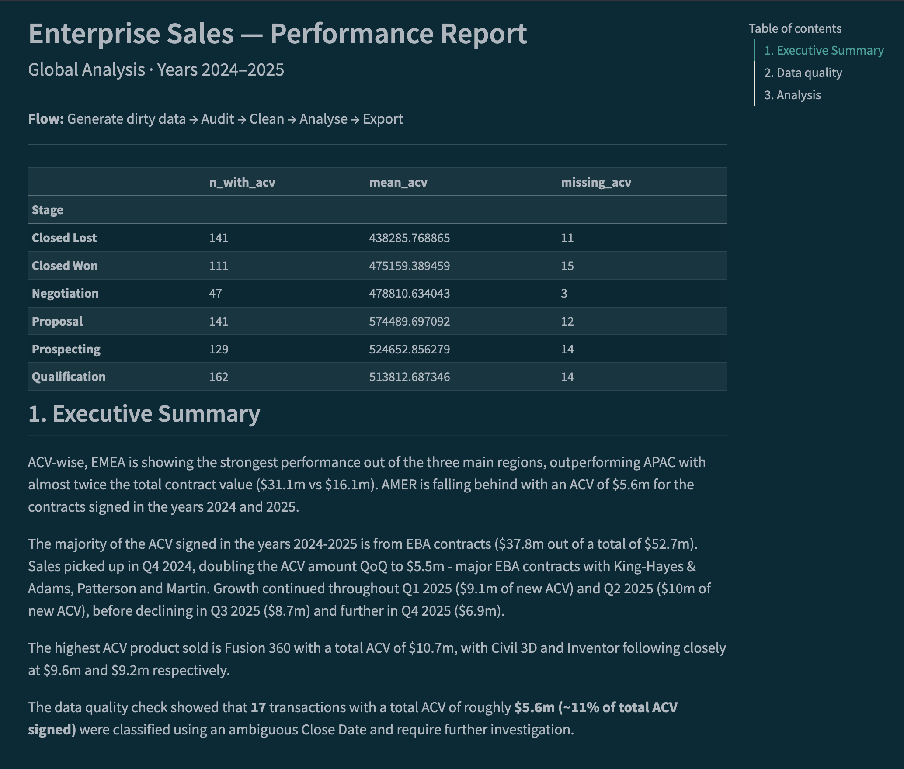

# Introduction

This project is a learning exercise that aims to produce a senior-stakeholder-ready report package, differently from the usual PowerPoint presentation. 
The data used in this project is fictitious, but it aims to reproduce reporting dimensions typically encountered in corporate settings. The objective is to generate, clean, aggregate and analyse enterprise-level sales data.

The report is located at ...

# Data

The dataset is synthetic, generated with the script `generate_enterprise_sales_data.py`. The goal was to produce results categorised in a way that could be presented by publicly traded software companies. 
As is expected in a real-world scenario, there are some common issues with the data: missing values, duplicates, outliers and inconsistencies in the naming and dates. All require cleaning before the data can be presented in a meaningful way.
Product and contract names are used for realism only; the data is not related to any company.

# Workflow

Data exploration was done in Jupyter (Anaconda); the final report is written in a Quarto document (`.qmd`) so it can be rendered into a single, self-contained HTML file and shared with stakeholders. Conda keeps the environment reproducible. 
When working from RStudio, point it to the environment’s Python by setting `QUARTO_PYTHON` (rendering) and `RETICULATE_PYTHON` (running single chunks) in `~/.Renviron`.

# Limitations

Despite cleaning the dataset, there are some issues which cannot be resolved and require follow-ups with the stakeholders.
The data quality check showed that 17 transactions, together accounting for roughly 11% of total ACV signed, were classified using an ambiguous Close Date and require further investigation.

# Key findings

For more information see the detailed report.

  - There was a significant increase in ACV for deals signed starting from Q4 2024, which continued to rise until the peak in Q2 2025 at $10m, before declining in Q3 2025 ($8.7m) and Q4 2025 ($6.9m).
  - EMEA is leading in 6 out of 7 products sold. A heatmap is a great tool to present financials broken down into categorical variables (product and region in this example).

# How to reproduce

Requirements: Conda (a plain .venv with the packages from environment.yml also works) and Quarto. Tested with Python 3.11 and Quarto 1.9.

  - Create the environment: `conda env create -f environment.yml`
  - Activate it: `conda activate enterprise-sales-case-study`
  - Register the Jupyter kernel used by the report: `python -m ipykernel install --user --name enterprise-sales-case-study`
  - (Optional) Regenerate the dataset: `python generate_enterprise_sales_data.py`. The raw CSV is already included in the repo.
  - Render the report: `quarto render enterprise_sales_report.qmd`

# Repo structure

  - `enterprise_sales_report.qmd`: report source
  - `enterprise_sales_report.html`: rendered report
  - `generate_enterprise_sales_data.py`: synthetic data generator
  - `enterprise_sales_raw.csv`: generated raw dataset
  - `environment.yml`: conda environment
  - `img/`: screenshot used in this README